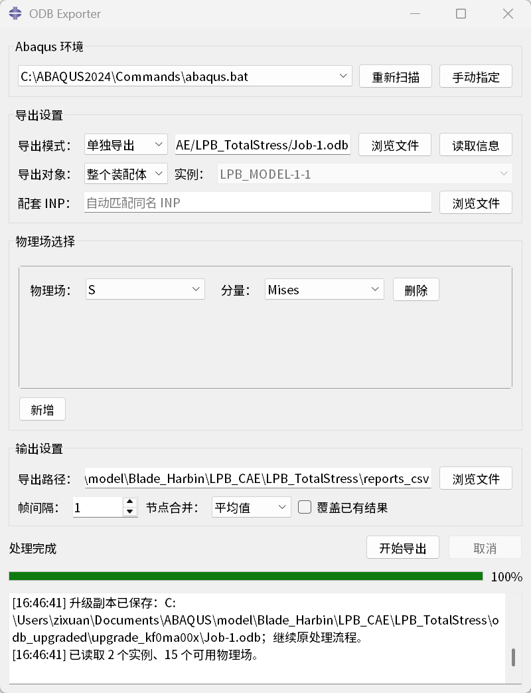
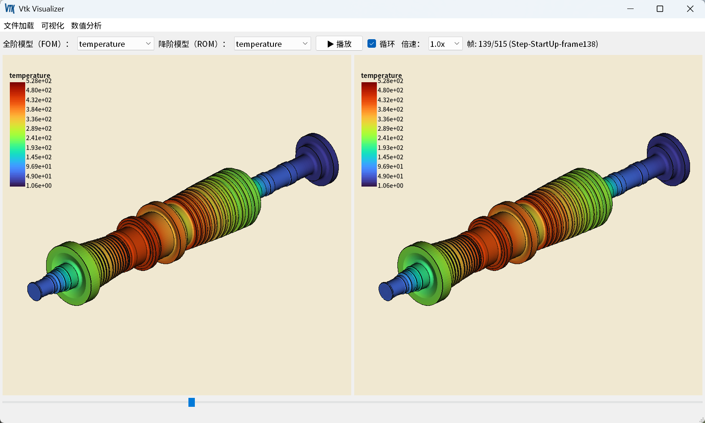

# ODB VTK Visualizer

Abaqus 物理场导出、全阶/降阶模型可视化与误差分析工具。

## 安装

需要 Python 3；ODB 导出另需本机安装 Abaqus。

```bash
pip install -r requirements.txt
```

## ODB Exporter



```bash
python odb_exporter.py
```

选择 Abaqus 环境、ODB、INP、物理场及分量，设置输出目录后点击“开始导出”；点击“新增”添加导出项。

- 单独导出：默认匹配同名 INP，也可手动指定。
- 批量导出：选择 ODB 目录和共用模板 INP，模板须与模型的实例及节点对应。
- 旧版 ODB 需要升级时弹窗确认，生成副本后继续，原文件保留。

CSV 每帧一行、每节点一列，按 INP 节点顺序排列。仅导出包含多个实例的装配体时生成节点映射表 `*_nodes.csv`，单实例不生成；映射表不作为物理场加载。

## VTK Visualizer



```bash
python vtk_visualizer.py
```

加载对应 INP 和 FOM/ROM 物理场数据，查看云图、动画及误差分析。

界面入口放在根目录；被调用的 Python 脚本统一放在 `script/`。ODB 导出后台为 `script/odb_export_backend.py`，需与入口一起保留。
